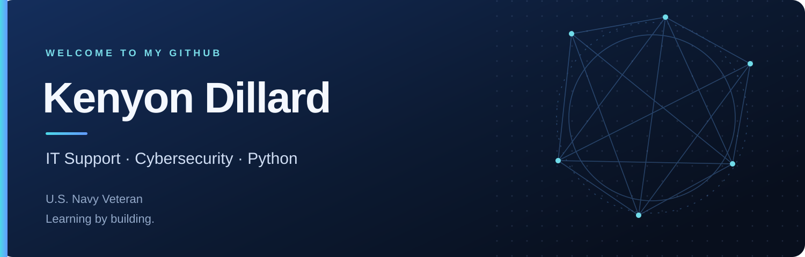

  <strong>IT Support Technician · U.S. Navy Veteran · Learning by building</strong>

  
  

### Hey, I'm Kenyon 👋

I'm an IT Support Technician at Marstel-Day and a U.S. Navy veteran based in Kokomo, Indiana. I enjoy troubleshooting, understanding how systems work, and finding practical ways to solve problems.

My background is in computer networks and cybersecurity. I'm learning Python through Boot.dev and using GitHub to share my progress as I build my programming skills.

- **Working in:** IT support and troubleshooting.
- **Learning:** Python, Git, and software development fundamentals.
- **Interested in:** security operations, threat analysis, and automation.

### Tools I'm learning & using

Python · Linux · SQL · Splunk · Suricata

My cybersecurity coursework introduced me to Linux, Python, SQL, and SIEM tools. I'm continuing that learning through home labs with Splunk and Suricata.

### What I'm focused on

| IT support | Cybersecurity | Python |
| --- | --- | --- |
| Solving technical problems and helping people use their systems. | Building on my coursework and hands-on security training. | Practicing the fundamentals and applying them in small projects. |

### Education & training

- **B.S., Computer Networks and Cybersecurity** — University of Maryland Global Campus.
- **MBA, in progress** — Western Governors University.
- **Google Cybersecurity Professional Certificate** — Coursera.
- **SOC Member & Malware Analyzer** — LetsDefend.
- **Introduction to Python** — Boot.dev.

### Follow my progress

Explore my [repositories](https://github.com/kenyonhd?tab=repositories) to see what I'm working on, or [connect with me on LinkedIn](https://www.linkedin.com/in/the-kenyon-dillard/).
